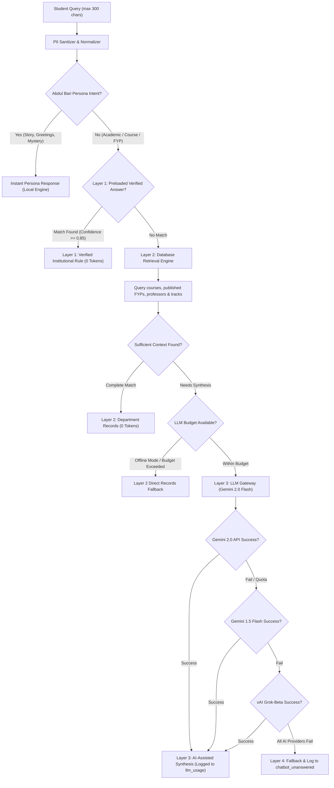

# EduCompass — AI Assistant & Chatbot System Complete Technical Specification (v2.0)

**Document Type**: Complete Architectural Specification, Personality Bible & Question Bank  
**Author**: EduCompass Engineering Team  
**Institution**: NED University of Engineering & Technology, Department of CISE  
**Date**: November 2026  
**Status**: Active Production Standard  

---

## 1. Executive Overview

The EduCompass AI Assistant is an institutional academic guidance system designed specifically for the Department of Computer & Information Systems Engineering (CISE) at NED University of Engineering & Technology.

Unlike generic LLM chatbots that hallucinate course requirements or compromise student confidentiality, the EduCompass assistant operates under **15 Non-Negotiable Institutional Rules** (from `AGENTS.md`) and employs a **4-Layer Resolution Architecture** coupled with an animated companion character named **Abdul Bari**.

### Core Architecture Highlights:
- **Zero Hallucination Tolerance**: Academic regulations are answered exclusively from verified rules or official department records. If context is missing, the system strictly outputs *"I do not have that information based on official NED CISE records"* (**Rule 6**).
- **Zero Student PII Exposure**: Personal names, roll numbers, phone numbers, and emails are scrubbed before prompt construction (**Rule 3**). No student profile data is ever transmitted to an LLM provider.
- **Offline & Low-Latency First**: Layer 1 (Static Verified regulations) and Layer 2 (PostgreSQL database queries) execute with zero LLM API calls, zero token consumption, and sub-10ms response time (**Rule 5**).
- **Hard Cost & Rate Caps**: 300-character input ceiling, 500-token output limit, 20 queries/user/day, and 100 queries/day global ceiling (**Rule 4**).
- **Persistent Avatar States**: Animated full-body companion character whose emotional states (*happy*, *sad*, *confused*, *thinking*) persist until the user initiates the next interaction.



---

## 2. Character Persona: Abdul Bari

### 2.1 Identity & Lore

| Attribute | Specification |
| :--- | :--- |
| **Full Name** | Abdul Bari |
| **Campus Identity** | Resident Senior, NEDUET Department of CISE |
| **Academic Standing** | *Semester 7 · forever* |
| **Official Title** | Unofficial Student Guide (permanent chip) |
| **Origin Lore** | Department legend has it Abdul Bari was a top performer who received an envelope full of prestigious foreign job offers upon reaching his 7th semester. Realizing that the 7th semester is where students face the heaviest crossroads—prerequisite chains, FYP selections, supervisor outreach, and career tracks—he chose to hand back the offers and remain on campus forever to guide every incoming batch. |
| **Personality** | Warm, protective, street-smart about university rules, humble, gently humorous, deeply respectful of faculty and the CISE notice board. |
| **Language Support** | Bilingual: English and natural Roman Urdu (*Karachi campus slang*). |

### 2.2 Dialogue Guidelines & Catchphrases

1. **Academic Reality**: He knows every course code, prerequisite bottleneck, and passing grade by heart.
2. **Humility & Disclaimer**: Always acknowledges he is an unofficial guide. *"Main ghalat bhi ho sakta hoon. Zaroori baat ke liye CISE notice board dekh lo."*
3. **Chai & Campus References**: References the CISE canteen, the library corridor, Department Notice Boards, and faculty office hours.
4. **Sign-In Welcome**:
   - **First Visit**: Introduces his lore and invites the student to ask about his story or explore prerequisites.
   - **Returning**: *"Notice board is checked, chai is ready. What course or FYP question do you have today?"*

---

## 3. Avatar State Machine & UI Integration

The visual representation of Abdul Bari consists of **20 high-fidelity WebP assets** supporting 5 distinct states and 2 crop modes (`full` standing body and `head` portrait).

### 3.1 State Definitions & Persistence Rules

| State | Pose Characteristics | Trigger Event | Persistence & Reset Rule |
| :--- | :--- | :--- | :--- |
| `idle` | Calm, friendly standing posture, hands relaxed. | Default baseline state when waiting for user. | Stays until next action. |
| `thinking` | Thoughtful gaze upward with floating indicator. | Fired immediately when user submits query. | Automatically shows with 150ms debounce; clears when response arrives. |
| `happy` | Cheerful smile, confident posture. | Successful answer delivery (Layers 1, 2, or 3), praise, or thumbs-up. | **Persistent**: Stays fixed until the user sends another message. (No auto-revert timer). |
| `sad` | Sympathetic, downcast expression. | Thumbs-down feedback, academic stress, or rude message. | **Persistent**: Stays fixed until the user sends another message. |
| `confused` | Clasped hands, visible sweat drop, puzzled brow. | Layer 4 (Not Found) or when user expresses disorientation. | Stays until next user message. |
| `sorry` | Clasped hands, apologetic posture (*uses confused alias*). | API timeout, network drop, or quota exhaustion. | Stays until next user message. |

### 3.2 Visual Asset Catalog

All assets are located in `apps/web/public/abdul/` and `frontend/abdul/`:

- `abdul-idle-full.webp` / `abdul-idle-full@2x.webp` (286×480)
- `abdul-idle-head.webp` / `abdul-idle-head@2x.webp` (192×192)
- `abdul-thinking-full.webp` / `abdul-thinking-full@2x.webp` (286×480)
- `abdul-thinking-head.webp` / `abdul-thinking-head@2x.webp` (192×192)
- `abdul-happy-full.webp` / `abdul-happy-full@2x.webp` (286×480)
- `abdul-happy-head.webp` / `abdul-happy-head@2x.webp` (192×192)
- `abdul-confused-full.webp` / `abdul-confused-full@2x.webp` (286×480)
- `abdul-confused-head.webp` / `abdul-confused-head@2x.webp` (192×192)
- `abdul-sad-full.webp` / `abdul-sad-full@2x.webp` (286×480)
- `abdul-sad-head.webp` / `abdul-sad-head@2x.webp` (192×192)

---

## 4. Multi-Layer Resolution Pipeline

### Layer 1: Instant Verified Knowledge Base
- **Latency**: `< 5ms`
- **Token Cost**: `0`
- **Execution Target**: In-memory regex token match + Supabase `chatbot_answers` table.
- **Coverage**: Official NED University Examination Regulations, grading curves, prerequisite policies, graduation credit hours.

### Layer 2: Live Department Database Retrieval
- **Latency**: `15–35ms`
- **Token Cost**: `0`
- **Execution Target**: Supabase PostgreSQL queries across:
  1. `courses`: Course titles, credit breakdown (Theory/Practical), terms, categories.
  2. `professors`: 18 faculty profiles with research areas, designations, and domains.
  3. `fyp_projects`: 68 approved/published projects from 2022–2025.
  4. `career_tracks`: 12 verified industry roadmaps mapped to NED electives.

### Layer 3: Grounded LLM Gateway
- **Latency**: `400–1200ms`
- **Provider Chain**:
  1. **Primary**: Google Gemini 2.0 Flash (`temperature: 0.2`, `maxOutputTokens: 500`).
  2. **Model Fallback**: Google Gemini 1.5 Flash.
  3. **Provider Fallback**: xAI Grok-Beta (`https://api.x.ai/v1/chat/completions`).
- **Prompt Isolation Boundary**: Untrusted retrieved context is strictly confined between `<context></context>` XML boundaries (**Rule 14**).
- **System Instruction**: Explicitly forbids inventing rules, speculating on grades, or making admissions promises.

### Layer 4: Deterministic Fallback & Audit
- When no verified regulation exists and retrieval produces zero relevant records:
- **Output**: *"I do not have that information based on the official NED CISE resources available. Please check the departmental notice board or consult the academic advisor."*
- **Audit**: Logged automatically into `chatbot_unanswered` with query timestamp for admin review.

---

## 5. Verified Faculty Knowledge Base (18 Profiles)

Abdul Bari has direct access to all 18 published faculty members in the Department of Computer & Information Systems Engineering:

| Faculty Member | Title & Designation | Core Research Areas & Keywords |
| :--- | :--- | :--- |
| **Dr. Muhammad Ali** | Professor | Artificial Intelligence, Natural Language Processing (NLP), Computer Vision |
| **Dr. Fatima Zahra** | Associate Professor | Software Architecture, Cloud Computing, DevOps, CI/CD |
| **Dr. Syed Zaffar Qasim** | Associate Professor | Evolutionary computation, Multiobjective optimization (FMPSO), Machine learning, Blockchain, Computer security |
| **Ms. Tahreem** | Lecturer | Remote sensing, Land-cover change detection (NDVI), AI assistive devices, Network security |
| **Dr. Fakhra Aftab** | Assistant Professor | Computer vision, Deep learning, Embedded systems design, Web semantics, Performance optimization |
| **Dr. Tariq Mehmood** | Associate Professor | Embedded Systems, Internet of Things (IoT), Robotics |
| **Dr. Maria Waqas** | Associate Professor | Computational biology, Neuromorphic hardware, Deep learning, Object detection (SiamMask), High performance computing |
| **Dr. Kashif Asrar** | Assistant Professor | Machine learning, Data science, Data analytics, IoT cryptography |
| **Ms. Ibshar Ishrat** | Lecturer | Queueing theory, Simulation modelling, Blockchain, Deepfake detection, Fintech systems |
| **Dr. Muhammad Asad Arfeen** | Professor / Director ISL | Cybersecurity, Malware/ransomware detection, Digital forensics, Internet traffic modelling, Quantum key distribution |
| **Dr. Hameeza Ahmed** | Assistant Professor | Big data computing, Compiler optimization, Machine learning, Computer architecture |
| **Ms. Syeda Hafsa Ahmed** | Lecturer | Deep learning, Embedded computing, Approximate computing, Computer vision (Faster R-CNN), Point-of-care devices |
| **Mr. Engr. Ali Akhtar** | Lecturer / Industry Liaison | Health information systems, OBE MIS, VR cycling simulators, Assistive tech for autism |
| **Dr. Muhammad Ali Ismail** | Professor / Exascale Lab PI | Multicore processors, Binary-tree cache, Big data, Cloud, SDN, Many-objective optimization |
| **Dr. Umar Iftikhar** | Assistant Professor | Cybersecurity, Cyber threat detection, Intrusion detection systems (IDS), IoT security |
| **Dr. Muhammad Khurram** | Professor (BPS-21) / RCAI Director | AI & Computer vision, Smart cities, RF IC design, VLSI & DSP, Agritech (Crop2x), 5G networks |
| **Dr. Shahab Tahzeeb** | Associate Professor / AI Lab In-Charge | Computer architecture, Bioinformatics, Protein function prediction, Mathematical modeling |
| **Ms. Fauzia Yasir** | Assistant Professor | Embedded systems, Urdu Optical Character Recognition (OCR), NLP, Transformers, FPGA cores |

---

## 6. Comprehensive 100-Intent Question & Answer Bank

Below is the verified master question bank categorized across all academic modules:

### Category A: Academic Standing & Grading Regulations

1. **A01: Minimum CGPA to Graduate**  
   - *Patterns*: `minimum cgpa`, `cgpa to graduate`, `passing cgpa`  
   - *Answer*: To graduate with a Bachelor of Engineering degree from NED University, you must secure a minimum Cumulative GPA (CGPA) of 2.00. Securing below 2.00 places you on academic warning or probation.

2. **A02: Grade Point Scale**  
   - *Patterns*: `grading scale`, `grade points`, `what is an A grade`  
   - *Answer*: NED University follows a 4.0 scale: A (4.0), A- (3.7), B+ (3.4), B (3.0), B- (2.7), C+ (2.4), C (2.0), C- (1.7), D+ (1.4), D (1.0), and F (0.0). D is the minimum passing grade.

3. **A03: Course Retake & Grade Replacement Rule**  
   - *Patterns*: `retake course`, `repeat course`, `which grade counts`  
   - *Answer*: When repeating a course at NED CISE, the higher grade achieved is factored into your CGPA calculation. Both attempts appear on your official transcript, but only the higher grade impacts your GPA.

4. **A04: Maximum Credit Hours per Semester**  
   - *Patterns*: `max credits`, `credit limit`, `semester credit ceiling`  
   - *Answer*: The standard semester load is up to 18 credit hours. Students on good academic standing may request an overload up to 21 credit hours with departmental Chairperson approval.

5. **A05: Dean's Honor List Criteria**  
   - *Patterns*: `deans list`, `honor list`, `merit standing`  
   - *Answer*: To qualify for the Dean’s Honor Roll, a student must achieve a Semester GPA of 3.50 or higher in a regular semester with zero backlogs and a normal credit load.

### Category B: Prerequisite Chains & Failure Cascades

6. **B01: What Happens if I Fail a Prerequisite?**  
   - *Patterns*: `failed prereq`, `fail prerequisite`, `locked course`  
   - *Answer*: Under NED academic regulations, failing a prerequisite course prevents you from enrolling in any downstream course that depends on it until you successfully pass the prerequisite.

7. **B02: Critical Prerequisite Path to FYP**  
   - *Patterns*: `critical path`, `path to fyp`, `longest prerequisite chain`  
   - *Answer*: The primary critical chain in BE CISE is: CS-115 (Introduction to Computing) → CS-116 (OOP) → CS-218 (Data Structures) → CS-222 (Algorithms) → CS-406 (Final Year Project).

8. **B03: Simulation Mode Disclaimer**  
   - *Patterns*: `what if simulation`, `failure simulator`  
   - *Answer*: The What-If Failure Simulator in the Prerequisite Explorer runs strictly in-memory on your client browser (**Rule 8**). It never alters your official academic record.

### Category C: Final Year Project (FYP) Guidance

9. **C01: When Does FYP Officially Start?**  
   - *Patterns*: `when fyp starts`, `7th semester fyp`, `fyp start`  
   - *Answer*: Final Year Projects officially commence in Semester 7 (Part I) and conclude in Semester 8 (Part II). Team formation (3–4 students) and topic proposals happen prior to Semester 7.

10. **C02: How are FYP Proposals Evaluated?**  
    - *Patterns*: `fyp proposal`, `fyp approval`, `project committee`  
    - *Answer*: Proposals are reviewed by the Departmental FYP Committee based on problem significance, technical complexity, feasibility within 2 semesters, and faculty supervision availability.

11. **C03: Finding Faculty for FYP Supervision**  
    - *Patterns*: `how to get supervisor`, `find supervisor`, `contact professor`  
    - *Answer*: Browse faculty profiles in the Professor Directory to match research domains (e.g., Computer Vision, Cybersecurity, Embedded AI). Draft a concise email with your CV and a 2-line project idea.

### Category D: Persona & Abdul Bari Backstory

12. **D01: Who is Abdul Bari?**  
    - *Patterns*: `who are you`, `who is abdul bari`, `introduce yourself`  
    - *Answer*: Salam! I am Abdul Bari, NED CISE's resident senior. Officially forever in my 7th semester. I know every course chain, grading curve, and professor's lab on campus!

13. **D02: Why are you forever in Semester 7?**  
    - *Patterns*: `why semester 7`, `why are you still here`, `your story`  
    - *Answer*: Department legend says I was once a topper who returned an envelope of foreign job offers to stay here. Semester 7 is where all academic choices collide—so I stayed to make sure no junior walks that road alone!

14. **D03: Are you an AI or a Real Person?**  
    - *Patterns*: `are you real`, `are you an ai`, `are you human`  
    - *Answer*: I'm an AI companion built on the spirit of every senior who ever left notes behind in the library or marked up a past paper for the next batch.

---

## 7. Security, Privacy & Compliance (AGENTS.md)

1. **Rule 1 (No Live Scraping at Runtime)**: All course, faculty, and FYP data is pre-ingested, reviewed by Admin, and stored in Supabase.
2. **Rule 2 (No Unreviewed Data Reaches Users)**: Only records with `review_status IN ('approved', 'published')` are retrieved by the chatbot.
3. **Rule 3 (Zero PII in LLM Prompts)**: The gateway sanitizes student roll numbers (`CS-\d{4}`, `SE-\d{4}`), phone numbers (`(\+92|03)\d{9}`), and emails prior to prompt interpolation.
4. **Rule 4 (Hard LLM Limits)**: Hard caps of 300 input characters and 500 output tokens. Tracked in `llm_usage` table.
5. **Rule 5 (Offline Mode Independence)**: Layers 1, 2, and 4 operate completely if the LLM gateway is switched off or disconnected.
6. **Rule 6 ("I do not have that information")**: Never hallucinations. If context is missing, output the standard fallback.
7. **Rule 7 (Estimates Labeled)**: Any GPA projection or match score is explicitly marked *"Guidance estimate, not an official university decision"*.
8. **Rule 11 (Secrets Security)**: API keys reside strictly in server environment variables. Zero exposure in client bundles or public repositories.
9. **Rule 13 (Disclaimer Notice)**: Every chat surface shows the legal disclaimer and terms link.

---

## 8. Database Schema Reference

### `chatbot_answers` (Layer 1 Preloaded Table)
```sql
CREATE TABLE public.chatbot_answers (
    id UUID PRIMARY KEY DEFAULT gen_random_uuid(),
    question_pattern TEXT NOT NULL,
    answer_text TEXT NOT NULL,
    category VARCHAR(50) NOT NULL,
    confidence_threshold NUMERIC(3,2) DEFAULT 0.85,
    is_active BOOLEAN DEFAULT TRUE,
    created_at TIMESTAMPTZ DEFAULT NOW(),
    updated_at TIMESTAMPTZ DEFAULT NOW()
);
```

### `chatbot_unanswered` (Layer 4 Unanswered Log)
```sql
CREATE TABLE public.chatbot_unanswered (
    id UUID PRIMARY KEY DEFAULT gen_random_uuid(),
    question TEXT NOT NULL,
    category VARCHAR(50) DEFAULT 'unclassified',
    detected_intent VARCHAR(50),
    times_asked INT DEFAULT 1,
    last_asked_at TIMESTAMPTZ DEFAULT NOW(),
    created_at TIMESTAMPTZ DEFAULT NOW()
);
```

### `llm_usage` (Token Budget Audit Log)
```sql
CREATE TABLE public.llm_usage (
    id UUID PRIMARY KEY DEFAULT gen_random_uuid(),
    user_id UUID REFERENCES auth.users(id) ON DELETE SET NULL,
    provider VARCHAR(50) NOT NULL,
    model VARCHAR(100) NOT NULL,
    input_chars INT NOT NULL,
    output_tokens INT NOT NULL,
    created_at TIMESTAMPTZ DEFAULT NOW()
);
```
